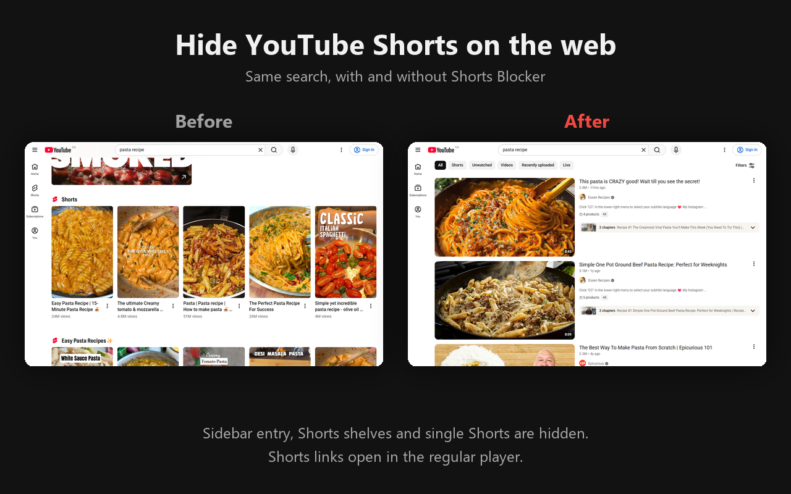

# Shorts Blocker for YouTube

A tiny Chrome extension that hides YouTube Shorts on the web. The YouTube mobile app lets you turn Shorts down, but the website doesn't.



- Hides the Shorts entry in the sidebar and the Shorts tab on channel pages
- Hides the Shorts shelves on home, search, subscriptions and watch pages
- Hides single Shorts mixed in with regular videos
- Hides Playables (YouTube's games): the sidebar entry, the home shelf and single game cards
- Opens `/shorts/<id>` links in the normal video player

Each option can be turned on or off from the toolbar popup. It works on `www.youtube.com` and `m.youtube.com`, in Chrome and in Firefox (desktop and Android).

The extension has no build step and no dependencies. It only asks for the `storage` permission (to save your settings) and access to YouTube pages.

## Install from source

1. Clone this repo.
2. Open `chrome://extensions` and turn on **Developer mode**.
3. Click **Load unpacked** and pick the repo folder.

## Install in Firefox

The same folder works as a Firefox add-on (Firefox 140+, or 142+ on Android).

- **Desktop, for testing:** open `about:debugging#/runtime/this-firefox`, click **Load Temporary Add-on**, and pick `manifest.json`. It stays loaded until Firefox restarts.
- **Android:** Firefox for Android only installs add-ons that Mozilla has signed, so the add-on has to be submitted to [addons.mozilla.org](https://addons.mozilla.org). Upload the same zip that `./pack.sh` builds.

## How it works

`content.css` hides Shorts with `:has()` selectors. Each group of rules only applies when a matching `data-sb-*` attribute is set on `<html>`. `content.js` sets those attributes from your settings and changes `/shorts/` URLs into `/watch?v=` URLs, including when you move between pages inside YouTube.

When YouTube changes its markup, the fix is usually one selector in `content.css`.

## Packaging for the Chrome Web Store

```sh
./pack.sh   # writes dist/shorts-blocker-<version>.zip
```

The same zip works for both stores. Upload it in the [Chrome Web Store Developer Dashboard](https://chrome.google.com/webstore/devconsole). The text for every listing field is in [STORE_LISTING.md](STORE_LISTING.md), and the screenshots and promo tile are in [`store/`](store). For the privacy section, the extension collects no data. See [PRIVACY.md](PRIVACY.md).

## License

MIT
